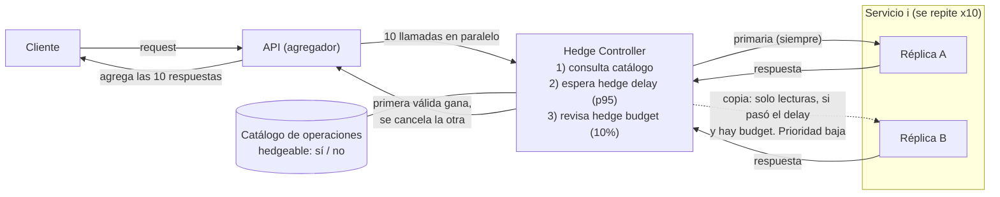

# Propuesta de solución: Hedged Requests + Hedge Budget

## Entregables
- [Video](https://drive.google.com/drive/folders/1icU8A23onPC_tp5Gi2Co0MsBmaJ8Gfv7?usp=sharing)

### Diagrama de arquitectura

**Arquitectura propuesta:**

Cada llamada de las 10 pasa por el controller. Las escrituras van solo a la réplica A, sin copia.

### La solución, en simple

El problema es que la API espera al servicio más lento de los 10. La idea es **no depender de una sola réplica**: cada servicio tiene dos (A y B), y para cada llamada la API hace esto:

1. Envía la request a A.
2. Si A tarda más de lo normal (el **hedge delay**, el p95 habitual de ese servicio), envía una copia a B, **siempre que quede presupuesto**.
3. Usa la primera respuesta que llegue y cancelar la otra.

Dos reglas la mantienen segura:

- **Solo se copian lecturas.** La API consulta un catálogo que dice si cada operación es `hedgeable`. El cliente no puede activarlo; como mucho puede desactivarlo (opt-out).
- **Hedge budget:** como máximo ~10% de copias respecto a las llamadas originales. Evita que las copias saturen el sistema.

Las copias además van con prioridad baja, para no quitarle lugar a las originales.

Los dos umbrales hacen cosas distintas:

| | Decide | Ejemplo |
|---|---|---|
| Hedge delay | **Cuándo** una llamada es candidata a copia | A no respondió en 40 ms (el p95 normal) |
| Hedge budget | **Cuántas** candidatas pueden enviar la copia | Solo si no se gastó el 10% |

### ¿Qué cambiarían?

| Componente | Antes | Después |
|---|---|---|
| Réplicas | Una por servicio | Dos por servicio (A y B) |
| API | Llama y espera | Pasa cada llamada por un Hedge Controller |
| Catálogo | No existe | Define qué operaciones se pueden copiar |
| Copias | No hay | Solo si pasa el hedge delay y hay budget |
| Colas | Una sola | Con prioridad (originales antes que copias) |
| Cancelación | No hay | Se cancela la copia que pierde |

La lógica de negocio de los servicios no cambia. El cambio vive en la API y en la capa de réplicas.

### ¿Por qué debería mejorar la tail latency?

- La latencia total es el máximo de las 10, así que un solo servicio lento arrastra todo. Con 5% de probabilidad de lentitud por servicio, ~40% de las requests salen lentas (1 − 0,95¹⁰).
- La lentitud suele ser mala suerte puntual (una pausa de garbage collection, una cola momentánea), no algo propio de la request. Es poco probable que **las dos réplicas** estén lentas a la vez: 5% pasa a ~0,25%.
- Con esa probabilidad, las requests lentas bajan de ~40% a ~2,5% si las 10 llamadas son lecturas. Si 2 de las 10 son escrituras sin copia, el piso queda en ~11%, porque esas llamadas conservan su cola. Son estimaciones con el modelo simple; el PoC las valida o las corrige.
- El paper (*The Tail at Scale*) lo respalda: en un benchmark de BigTable, enviar la copia tras 10 ms redujo el p99.9 de 1.800 ms a 74 ms con solo 2% más de requests.
- Esto solo funciona si la lentitud de A y B es **independiente**. Si ambas se degradan juntas (por ejemplo, una base de datos compartida), no ayuda.

### ¿Qué trade-off introduce?

**Trade-off = beneficio / costo**

| | Beneficio | Costo |
|---|---|---|
| Latencia | Baja el p95 y el p99, que es lo que percibe el usuario | Casi no cambia el p50 |
| Carga | | Hasta ~10% de llamadas extra (tope del budget) |
| Infraestructura | | Una segunda réplica por servicio (muchos sistemas ya la tienen por disponibilidad) |
| Complejidad | | Catálogo, controller, cancelación y colas con prioridad que mantener |
| Cobertura | | Las escrituras no se benefician y dejan un piso en el p99 |
| Riesgo | | Bajo saturación, las copias pueden empeorar las colas. El budget y la prioridad baja lo mitigan |

**Cómo se expresa el ratio:** el beneficio es cuánto baja el p99 (en %) y el costo es el % de llamadas extra. En el PoC se reporta como "bajó el p99 en X% con Y% de requests adicionales". El paper muestra que esa relación puede ser muy favorable (casi 25× menos latencia en p99.9 con 2% de carga extra), pero el PoC debe medir la nuestra, incluyendo desde qué nivel de carga el hedging deja de convenir.